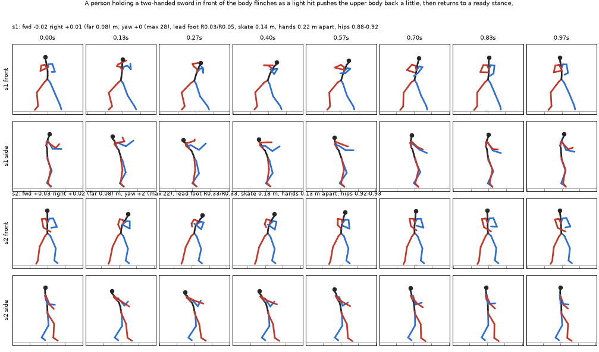

# hymotion-local

Run [Tencent HY-Motion 1.0](https://github.com/Tencent-Hunyuan/HY-Motion-1.0) text-to-motion on your own
machine with one 12 GB GPU, and get game-ready clips out: BVH (and FBX through Blender) with Mixamo bone
names, a contact sheet to look at, and numbers that describe each take (travel, turn, foot sliding,
stance, hand distance). It is built for AI coding agents as much as for people. An agent can install it,
write prompts, generate several takes, read the sheets, pick the best take and hand it to an engine.

The official release asks for 24-26 GB of VRAM. This tool fits in 12 GB without lowering quality. It runs
the Qwen3-8B text encoder in bf16, as the reference does, and keeps the layers that don't fit on the GPU in
system RAM. It caches each prompt's encoding, so new seeds, guidance or step counts for that prompt skip
the encoder.



*`motion.py gen "A person holding a two-handed sword ... flinches as a light hit pushes the upper body back ..." --dur 1 --seeds 1,2`:
each take's front and side rows, with its numbers above.*

> **Agents:** read [AGENTS.md](AGENTS.md). It covers installing, generating, choosing takes and the pitfalls.

## Requirements

- An NVIDIA GPU with 12 GB or more (tested on an RTX 3060 12 GB), and a recent driver.
- 32 GB of system RAM. The text encoder's overflow (about 7 GB) and the model load sit there.
- About 25 GB of free disk for the weights, plus about 3 GB for the Python environment.
- Python 3.10-3.12 on Windows or Linux. Git is not needed.
- Optional: [Blender](https://www.blender.org/) 3.6+ for `--fbx` export.

## Install

```bash
git clone https://github.com/rottenvia/hymotion-local
cd hymotion-local
python install.py --accept-license
```

`install.py` does five things:

1. Fetches HY-Motion's code at a pinned commit, plus its git-lfs files.
2. Creates `HY-Motion-1.0/.venv` with a CUDA build of PyTorch (`--cuda cu128` for RTX 50xx).
3. Installs `requirements.txt`.
4. Downloads the weights (about 22 GB) from Hugging Face.
5. Runs `motion.py doctor`.

It is safe to re-run.

`--accept-license` means you accept the
[Tencent HY-Motion 1.0 Community License](https://github.com/Tencent-Hunyuan/HY-Motion-1.0/blob/main/License.txt),
which covers the model and its code. That license does not apply in the EU, the UK or South Korea, and
products with more than 1M monthly users need Tencent's permission. Tencent claims no rights in the motions
you generate. This repository holds only the wrapper code (MIT); it contains no Tencent code or weights.

Other flags:

- `--home DIR` puts everything in another folder, or reuses an existing HY-Motion checkout.
- `--system-torch` reuses a CUDA torch that is already installed.
- `--no-weights` sets up the code and env only.

## Use

```bash
python motion.py gen "A person swings a two-handed sword from the right shoulder down to the left hip." --name slash --dur 2 --n 4
python motion.py batch examples/sword_set.json --out clips
python motion.py sheet motion_out/slash --seed 2      # a close-up of one take
python motion.py fbx motion_out/slash                 # FBX copies through Blender
python motion.py loop motion_out/walk                 # each take's best cycle as a seamless loop
python motion.py doctor
```

Each job writes `<out>/<name>/`:

| file | what |
|---|---|
| `<name>_<seed>.bvh` | the take: 52 SMPL-H joints named `mixamorig:Hips`, `mixamorig:LeftArm`, ...; Y up, facing +Z, metres, 30 fps, feet on y = 0 |
| `<name>_<seed>.npz` | `keypoints` (frames x 52 x 3 world joints), `poses` (frames x 156 SMPL-H axis-angle, as in the BVH), `trans`, `fps` |
| `<name>_<seed>.fbx` | with `--fbx`: the same armature and animation as FBX (Mixamo names, for Unity / Unreal / Roblox / Mixamo retargeters) |
| `sheet1.png` ... | per take a front row (the character faces you) and a side row (seen from its right); red is its right side, blue its left. Each cell is centred on the hips; the floor ticks every 0.5 m show how far it travels |
| `job.json` | every setting, plus each take's numbers |

The numbers printed per take, also in `job.json` and on the sheet:

- `fwd` / `right`: how far the hips end up, in metres, relative to the take's starting facing.
- `far`: the furthest the hips get from the start.
- `yaw`: the final turn, with `max` the largest turn along the way.
- `lead foot`: which ankle is ahead and by how much, at the start and at the end (`R0.25` = the right foot is 0.25 m ahead).
- `skate`: metres a planted foot slides.
- `hands`: the median wrist-to-wrist distance (about 0.1-0.2 m means both hands are on one handle).
- `hips`: the lowest and highest hip height.

### Settings

| flag | default | effect |
|---|---|---|
| `--dur` | 3.0 | seconds, 0.67-12. The model is best under 5 s. |
| `--seeds` / `--n` | 0..n-1 / 4 | which takes to make. The same seed and settings always give the same take. |
| `--cfg` | 5 | text guidance. Around 3 is looser and more natural; 7+ is stiffer and exaggerated. |
| `--steps` | 50 | flow-matching steps. Fewer is faster and rougher. |
| `--solver` | euler | any torchdiffeq method: `midpoint`, `rk4`, `dopri5` (adaptive). |
| `--game` | off | the model's "game data" source token. |
| `--smooth` | 1 | joint smoothing sigma. 0 gives raw output. |
| `--head` | steady | `steady` removes the model's stray twist of the neck and head about the neck (20-50 deg: the face looked off to one side). No joint moves. `raw` keeps the model's rotations. |
| `--tf32` | off | TF32 matmuls: about 25% faster; joints stay within about 0.2 deg. |
| `--fbx` | off | also write FBX (needs Blender; set `$BLENDER` if it isn't found). |
| `--out` | `./motion_out` | the output root (or `$HYMOTION_OUT`). |
| `--model` | full | the path of another checkpoint folder, e.g. HY-Motion-1.0-Lite if you download it. |

Speed on an RTX 3060: the first new prompt costs about 1-2 minutes to load the text encoder. After that,
50 steps for 4 takes take about 40-45 s. The model always samples its full 12 s window and keeps your clip's
frames, so a short clip is no faster than a long one, and trimming that window changes the result.

### Loops

The model can't make a loop itself: a walk drifts, and its last step never meets its first.
`motion.py loop JOB_DIR` finds the stretch of each take that repeats best and turns it into a seamless loop
in `JOB_DIR_loop/` (BVH, npz, sheets and `job.json`, laid out like a job, so `sheet` and `fbx` work on it):

- It searches periods from `--min` to `--max` seconds (0.5-2 by default: a walk's or run's two strides).
  It compares each frame with the frame one period later: joint positions in the body's own facing, plus
  their velocities. Of the periods within 15% of the best match, the shortest wins, so it takes one gait
  cycle, not two. Half a cycle is the mirror pose, so it never passes for a whole one.
- The heading's drift over the cycle is taken out. The last `--blend` seconds (0.25) ease onto the same
  phase one period earlier, so the last frame is the first one moved by a cycle's travel.
- `--align travel` (the default) turns the loop so that it travels straight ahead, back, right or left,
  whichever is nearest: a sword stance walks 10-20 deg off its chest. `--align body` faces it +Z instead.
- For an idle, ask for a longer, slower cycle: `--min 2 --max 4`.

Each loop's numbers add `period`, `start` (where in the take it was found), `seam` (cm of mismatch the blend
hid; under about 5 cm is invisible on a walk), `speed` (m/s) and `way` (deg, 90 = its right).

## Prompting

HY-Motion was trained on short English captions of one person's body movement. Its own "prompt rewriter"
(a 32B LLM, not needed here) only fixes grammar and estimates the duration. Write the caption yourself:

- Start with "A person ...". Use one sentence, or a few short clauses in time order, under about 60 words.
- Name body parts, directions and sides: "raises both hands above the right shoulder", "steps back with
  the left foot", "the upper body twists to the left". Left and right are the character's own.
- Props are fine as context ("holding a two-handed sword"), but the model only moves the body. It has no
  sword, so the hands roughly mime the grip.
- Don't describe scenes, cameras, emotions, clothing or other people. Don't ask for a seamless loop or an
  in-place motion; trim or loop the clip afterwards.
- Make 4-8 takes of every prompt and pick by the sheet and the numbers. Takes differ a lot.

What works well: hit reactions, staggers, falls and deaths, hops and dodges, guards and parries,
kneeling, gestures, everyday actions, walking and running.

What is unreliable: exact foot placement ("right foot forward" is often ignored), exact weapon lines in
fast swings (big swings tend to twist the whole body and can turn the back to the target), exact facing
over long motions, and precise timing. In-place and looping motions drift.

[examples/sword_set.json](examples/sword_set.json) holds 41 worked prompts for a sword-fighting game:
cuts in 8 directions, light cuts, thrusts, hit reactions, deaths, guards and locomotion.

## Using the clips

- **Blender:** File > Import > Motion Capture (.bvh), with forward -Z and up Y (the defaults). The
  armature then faces -Y and stands on the floor.
- **Mixamo-style retargeting** (Unity Humanoid, Unreal IK Retargeter, Rokoko, Auto-Rig Pro, ...): use the
  FBX. The bone names follow Mixamo's.
- **Your own pipeline:** `npz["keypoints"]` gives world joint positions per frame, and `npz["poses"]`
  gives local SMPL-H rotations on the bundled template skeleton.
- The model makes 22 body joints. The fingers carry the SMPL-H mean relaxed hand pose.
- For walks, runs and idles, run `motion.py loop` on the job and use the `_loop` takes.
- The model learnt rotations from joint positions, so a turn of a bone about its own length is only
  loosely pinned. `--head steady` fixes the head. On the limbs it is small, but solve wrists and
  forearms from positions if your rig shows candy-wrapper twists.
- For game reactions (hits, staggers, deaths), check `yaw` and `far`. A take often turns 20-60 deg or
  travels a metre that you did not ask for; a death can fall towards the attacker. Take part of the
  turn out about the hips, or scale the root's travel, when you retarget.

## Troubleshooting

- **CUDA out of memory:** close other GPU apps (games, browsers with hardware acceleration), use fewer
  seeds per job, or pass `--tf32`. The encoder keeps 2 GiB of headroom below the free VRAM it finds.
- **RAM:** the text-encoder step needs about 20 GB of free system RAM the first time each prompt is seen.
- **`motion.py doctor`** checks the env, GPU, weights and Blender, and verifies its forward kinematics
  against HY-Motion's own body model.

## License

The wrapper code in this repository is MIT (see [LICENSE](LICENSE)). HY-Motion 1.0, its code and weights are
© Tencent and under the Tencent HY-Motion 1.0 Community License; `install.py` downloads them from their
official sources.
